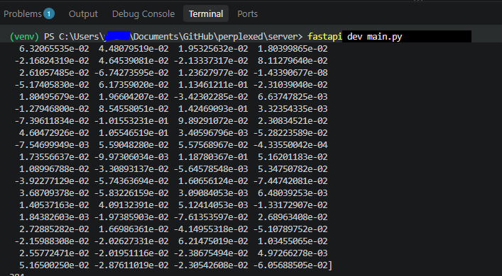
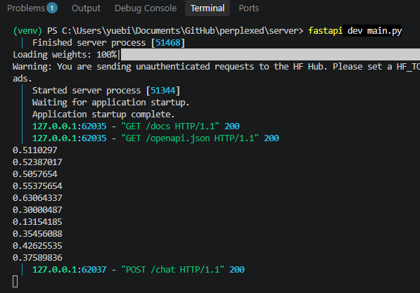
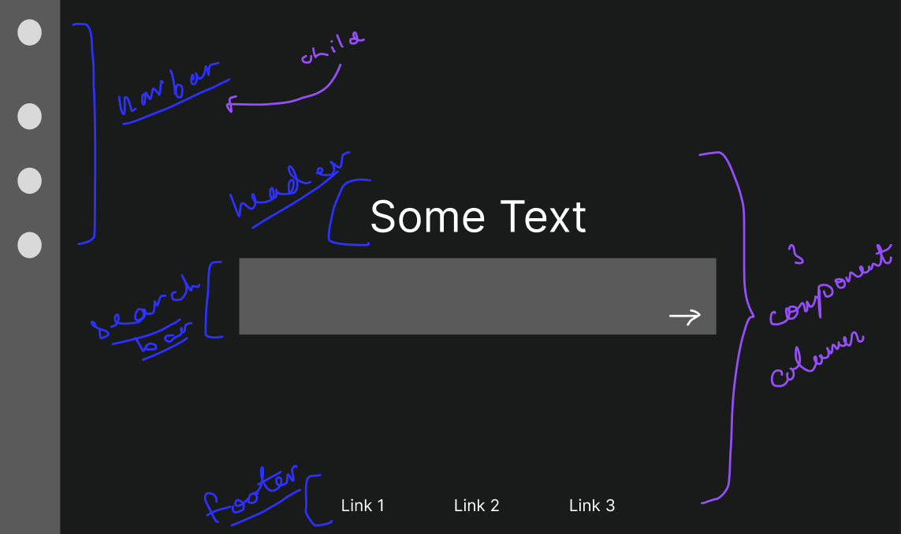
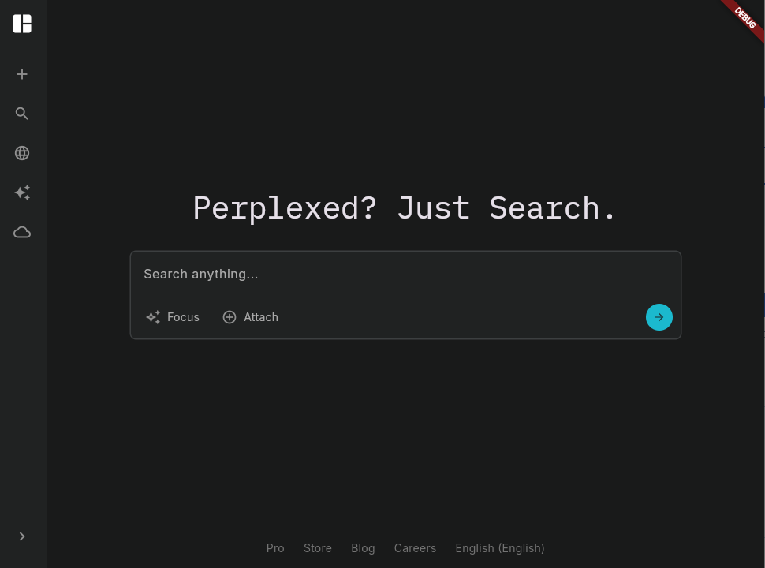

Perplexed is an AI-powered search engine based on the popular application Perplexity.

# Perplexed

# Background

In building Perplexed, there were a few key background concepts critical to building it.

## Vectorization/Embedding

A key determinant of a good search engine is how good it is at returning relevant results, or for our case, how relevant we can make our returned links/results form the web to the user's prompt. In the context of an AI search engine, how we can realize this is by how good we can make the similarity analysis of potential search results and our prompt.

To analyze the similarity, we follow the two step process:

- **Vectorization/embedding**: Convert our unstructured prompts to more standardized/uniform and--most importantly--mathematically comparable multidimensional vectors. For this, we use an embedding model.
  - _On the number of dimensions_ - The two main tradeoffs and considerations when determining dimensions include time and accuracy.
    - Note that beyond extreme values (i.e. very small dimensions), a greater dimension does not directly correlate in any linear pattern to better effectiveness for similarity checks.
  - _On embedding models_ - Lots of companies like OpenAI, Gemini have their own embedding models, but they may cost more than just open source ones. In our case we will use one of the latter.
  - For visualization, here's part of an example of an vector that was generated by an open source embedding model of one of the example propmts we tested during local development:
    - 
- **Similarity function**: Using a similarity function, compare our vectors.
  - Example of similarity scores generated on a test run:
    - 

## Cosine Similarity

For the second step, there are many possible functions we can use, and from those we chose cosine similarity search for, among others, the following reasons:

- It is one of the most widespread/popular metrics
- Prioritizes measuring the direction between two result vectors instead of magnitude, which is more ideal for longer prompts/documents/text

The Cosine Similarity function itself is:

$$
\begin{equation*}
    f(A, B) = \frac{A\cdot B}{\lVert A \rVert \lVert B \rVert}
\end{equation*}
$$

which literally represents the $\cos$ of the angle between the two vectors. This, it generates a number from 1 to -1, and the larger the number, the more similar two vectors are.

# V1.0 Development Documentation

When building perplexed, we used the following tools and languages:

- The language **Dart**
- **Flutter** as our frontend framework
- **FastAPI**, a web framework based on Python for building APIs
- **Tavily**, a third-party api which enables fetching AI-based search results
- **Trafilatura** package to scrape web pages
- **SentenceTransformers** for their embedding models
- **Gemini AI Studio** for its API

During local development, we used a Python virtual environment to isolate our project dependencies. To install it for our project, we ran `python3 -m venv venv` under our `/server` directory and activated it via terminal with `./venv/Scripts/Activate.ps1`.

## Part 1: Homepage UI

Our front page can be split into two primary children: a navbar on the far left, and a 3-element column in the center which includes a header, search bar, and footer:

To build this out, we created the following widgets under `lib/widgets`, for which `home_page.dart` then references.

- `SideBarButton`, `FooterLink` and `SearchBarButton` widgets are pretty self explanatory
- `SideBar` is a stateful widget containing five `SideBarButton` elements. Its state tracks if the bar is collapsed or not.
- `SearchSection` consisting of a search bar, three `SearchBarButton`s, and a blue search button

Then `home_page.dart` simply contains one `SideBar` widget and a column with a `SearchBarSection` and row of `FooterLink`s. The result looks something like the below.

### Part 2: Server

A huge chunk of Perplex's backend is our server, which contains our API that talks to the AI models to enable the core functionality of an 'AI powered' search engine. For this, we used the python-based framework FastAPI which is dependent on Uvicorn as the actual web server.

Our server, of which the most important function is `chat_endpoint` that takes in a user's query to output a result, has three services which the latter uses in sequence.

#### Search Service

`search_service.py` takes in the query and outputs info/sources from the web.

There are two primary approaches we considered for getting results from the web. The first is using Gemini to split your query into multiple smaller queries (the potential issue with only doing one query is, for instance, if the user inputs their whole life story for their query, plugging that all into Google all at once is unlikely to return much useful search results), and searching each of those on the internet. The second is using a third-party service such as `Tavily` to get the search results. For the time being, we implemented the second approach as it is more direct.

After getting sources, we also wanted to get the content of the webpages too instead of simply the URLs themselves. So we scrape the URLs as well, using `Trafilatura`. This portion of `search_service.py` could technically be broken into a separate step, but we kept it here because the function currently returns the each of the results in elements which contain the url, title, and content of pages bundled into one.

### Sorting Service

Covered in the Background section above.

We sort the list of results we get from `SearchService` by non-decreasing similarity to the user's prompt.

### LLM Service

Generate the final output/response using the Gemini API.
